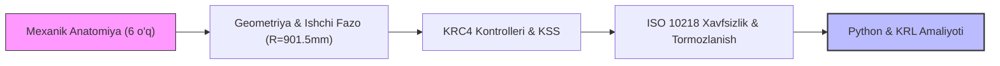
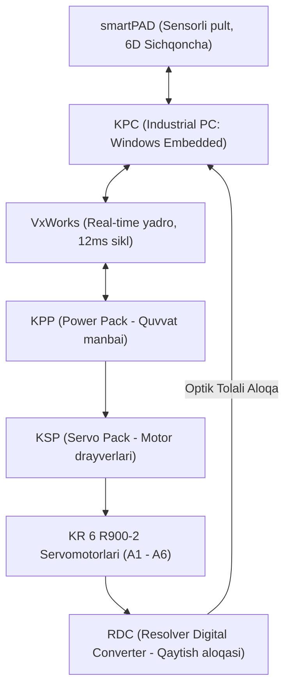

# 1-Dars: KUKA KR AGILUS (KR 6 R900-2) Sanoat Manipulyatori, Apparat Anatomiyasi, Boshqaruv Tizimi va Xavfsizlik Standartlari
## Sanoat Robototexnikasi Darsligi | 1-Bob: Asoslar va Simulyatsiya

[](../README.md)
[-orange.svg)](https://www.kuka.com)
[](https://www.kuka.com)
[](#)
[](https://www.samdu.uz)

---

## 📌 Dars Mundarijasi (Taqdimot Rejasi)

1. [Darsning Maqsadi va Kirish](#1-darsning-maqsadi-va-kirish)
2. [1-Taqdimot: KUKA KR 6 R900-2 Manipulyatorining Mexanik Anatomiyasi](#2-1-taqdimot-kuka-kr-6-r900-2-manipulyatorining-mexanik-anatomiyasi)
3. [2-Taqdimot: Geometrik O'lchamlar va Ishchi Fazo (Workspace) Matematikasi](#3-2-taqdimot-geometrik-olchamlar-va-ishchi-fazo-workspace-matematikasi)
4. [3-Taqdimot: KUKA KRC4 / KRC5 Boshqaruv Tizimi va KSS Arxitekturasi](#4-3-taqdimot-kuka-krc4--krc5-boshqaruv-tizimi-va-kss-arxitekturasi)
5. [4-Taqdimot: Xalqaro Sanoat Xavfsizligi Normalari va Tormozlanish Dinamikasi](#5-4-taqdimot-xalqaro-sanoat-xavfsizligi-normalari-va-tormozlanish-dinamikasi)
6. [5-Taqdimot: Python Bilan Amaliy Laboratoriya va Simulyatsiya](#6-5-taqdimot-python-bilan-amaliy-laboratoriya-va-simulyatsiya)
7. [6-Taqdimot: KRL Dasturiy Muhiti (WORKSPACE_CHECK)](#7-6-taqdimot-krl-dasturiy-muxiti-workspace_check)
8. [Talabalar Uchun Amaliy Vazifalar va Nazorat Savollari](#8-talabalar-uchun-amaliy-vazifalar-va-nazorat-savollari)

---

## 1. Darsning Maqsadi va Kirish

Ushbu dars robototexnika sohasidagi bo'lajak muhandislar, magistrlar va ilmiy tadqiqotchilar uchun mo'ljallangan fundamental kirish darsidir.

> [!NOTE]
> **Darsning Asosiy Maqsadi:**
> KUKA kompaniyasining eng ommabop 6 erkinlik darajali ixcham manipulyatorlaridan biri bo'lgan **KUKA KR 6 R900-2 (KR AGILUS-2)** ning kinematik anatomiyasini, harakat o'qlarining fizik chegaralarini, KRC4/KRC5 kontrollerining ishlash mexanizmini va robot xavfsizlik zonalarini hisoblash matematik apparatini nazariy hamda Python dasturi yordamida chuqur o'rganish.



---

## 2. 1-Taqdimot: KUKA KR 6 R900-2 Manipulyatorining Mexanik Anatomiyasi

KUKA KR AGILUS oilasiga mansub KR 6 R900-2 manipulyatori — vertikal antropomorfik (inson qo'li tuzilishiga o'xshash) sanoat roboti bo'lib, uning barcha 6 ta bo'g'ini faqat aylanma (revolute) harakat qiladi.

### 🦾 Bo'g'inlarning Fazoviy Joylashuvi va Vazifasi:

```
                          [A5 & A6: Sferik Bilak va Flanets]
                                        O====[Asbob Flanetsi (d6=80mm)]
                                       /
                                      / (Bilak zvenosi: d4=420mm, a3=35mm)
                                     /
               (A3: Tirsak bo'g'ini) O====O (A4: Bo'ylama burilish o'qi)
                              /
                             / (Yuqori qo'l zvenosi: a2=455mm)
                            /
  (A2: Yelka bo'g'ini)     O
                           |
                           | (Baza ustuni: d1=400mm, a1=25mm)
                           |
                 [A1: Asos burilish o'qi]
                    =================
                      [ROBOT BAZASI]
```

### 📊 Bo'g'inlarning Texnik Tavsifi Jadvali:

| Bo'g'in (Axis) | Nemischa / Inglizcha Nomi | Harakat Turi | Burilish Diapazoni | Maksimal Burchak Tezligi | Fizik Vazifasi |
| :---: | :--- | :--- | :---: | :---: | :--- |
| **$A_1$** | Karussell / Carrousel | Gorizontal burilish | $\pm 170^\circ$ | $360^\circ/\text{s}$ | Manipulyatorni vertikal o'q atrofida butunlay burish |
| **$A_2$** | Schwinge / Link arm | Vertikal egilish | $-190^\circ / +45^\circ$ | $300^\circ/\text{s}$ | Qo'lni oldinga va orqaga harakatlantirish (Yelka) |
| **$A_3$** | Arm / Arm | Vertikal egilish | $-120^\circ / +156^\circ$ | $360^\circ/\text{s}$ | Asbob balandligini sozlash (Tirsak) |
| **$A_4$** | Zentralhand 1 / Arm roll | Bo'ylama burilish | $\pm 185^\circ$ | $381^\circ/\text{s}$ | Bilakning o'z o'qi atrofida buralishi |
| **$A_5$** | Zentralhand 2 / Wrist pitch | Vertikal bukilish | $\pm 120^\circ$ | $388^\circ/\text{s}$ | Asbob uchini yuqoriga/pastga egish |
| **$A_6$** | Flansch / Flange roll | Cheksizga yaqin burilish | $\pm 350^\circ$ | $615^\circ/\text{s}$ | Asbobning (tutqich, payvandlash foni) aylanishi |

> [!IMPORTANT]
> **Sferik Bilak (Spherical Wrist) Muhimligi:**
> Oxirgi uchta o'q ($A_4, A_5, A_6$) bitta geometrik nuqtada kesishadi. Bu mexanika **Sferik Bilak** deb ataladi. U robot kinematikasini soddalashtiradi: dastlabki uchta o'q ($A_1, A_2, A_3$) asbobning **fazoviy o'rnini (X, Y, Z)** aniqlasa, keyingi uchta o'q ($A_4, A_5, A_6$) asbobning **orientatsiyasini (A, B, C)** ta'minlaydi.

---

## 3. 2-Taqdimot: Geometrik O'lchamlar va Ishchi Fazo (Workspace) Matematikasi

Manipulyatorning aniq o'lchamlari va kinematik zanjiri KUKA zavod chizmalaridan olinadi:

* **$d_1 = 400.0\text{ mm}$:** Robot tagidan $A_2$ yelka bo'g'ini markazigacha vertikal masofa.
* **$a_1 = 25.0\text{ mm}$:** $A_1$ aylanma o'qi bilan $A_2$ gorizontal o'qi orasidagi ofset.
* **$a_2 = 455.0\text{ mm}$:** $A_2$ yelka o'qidan $A_3$ tirsak o'qigacha bo'lgan zveno uzunligi.
* **$a_3 = 35.0\text{ mm}$:** $A_3$ o'qidan bilak markaziga gorizontal siljish.
* **$d_4 = 420.0\text{ mm}$:** $A_3$ tirsak o'qidan bilak kesishish markazigacha ($A_5$) masofa.
* **$d_6 = 80.0\text{ mm}$:** $A_5$ bilak markazidan mexanik asbob flanetsigacha bo'lgan masofa.

```
          a1=25 mm      a2=455 mm            d4=420 mm        d6=80 mm
        |<-->|     |<-------------->|     |<------------->|   |<-->|
        +----+-----+----------------+-----+---------------+---+----+
        | A1 |     |       A2       | a3= |      A4       | A5| A6 |
        +----+-----+----------------+ 35mm+---------------+---+----+
             ^                      ^                     ^
             | d1=400 mm            |                     |
        [POL / BASE]         [YELKA BO'G'INI]       [BILAK MARKAZI]
```

---

### 🧮 Teorema 1: Uchburchak Tengsizligi va Maksimal Yetib Borish Chegarasi

Har qanday zvenoli manipulyatorning fazoda erisha oladigan maksimal masofasi bo'g'in zvenolari uzunliklarining vektorli yig'indisiga teng.

> **Teorema (Kinematik Yetib Borish Chegarasi):**
> Yelka bo'g'ini markazi $S = [a_1, 0, d_1]^T$ dan bilak markazi $\vec{p}_{wc}$ gacha bo'lgan masofa uchburchak tengsizligi bilan chegaralanadi:
> $$R_{max, wc} = a_2 + \sqrt{a_3^2 + d_4^2}$$
> $$R_{max, wc} = 455.0 + \sqrt{35.0^2 + 420.0^2} = 455.0 + 421.46 = 876.46\text{ mm}$$
> Mexanik flanetsning nominal katalog bo'yicha maksimal yetib borish radiusi esa:
> $$R_{max, catalog} = 901.5\text{ mm}$$

#### ⚠️ Ichki O'lik Zona (Dead-Zone Singulyarligi):
Agar robot o'z qo'lini orqaga buksa, bilak markazining yelkaga eng yaqin kelish masofasi:
$$R_{min, wc} = |a_2 - \sqrt{a_3^2 + d_4^2}| = |455.0 - 421.46| = 33.54\text{ mm}$$
Bu shuni anglatadiki, yelka o'qining atrofidagi $33.54\text{ mm}$ lik radiusdagi sferaga robot asbobi fizik jihatdan **hech qachon yeta olmaydi**!

---

## 4. 3-Taqdimot: KUKA KRC4 / KRC5 Boshqaruv Tizimi va KSS Arxitekturasi

KUKA sanoat robotlarining "miyasi" bu — **KRC (KUKA Robot Controller)** apparat-dasturiy majmuasidir.

### 🖥️ KRC Kontrollerining Ichki Bloklari:



1. **KPC (KUKA Control PC):** Sanoat kompyuteri. Windows muhitida foydalanuvchi interfeysini ta'minlaydi.
2. **VxWorks Real-Time Yadro:** Traektoriyani rejalashtirish, kinematika hisoblari va interpolatsiyani har **$12\text{ ms}$** (yoki tezkor rejimda **$4\text{ ms}$**) da uzluksiz bajaradi.
3. **KPP (KUKA Power Pack) va KSP (KUKA Servo Pack):** 3 fazali o'zgaruvchan tokni dvigatellarni boshqaruvchi yuqori chastotali signallarga aylantirib beradi.
4. **RDC (Resolver Digital Converter):** Robot bazasida joylashgan mikro-blok. Dvigatellarning analog resolver signallarini raqamli burchaklarga aylantirib, KPC ga optik tolali kabel orqali uzatadi.

---

## 5. 4-Taqdimot: Xalqaro Sanoat Xavfsizligi Normalari va Tormozlanish Dinamikasi

Sanoat robototexnikasida inson hayoti va salomatligi eng ustuvor vazifadir. Barcha tizimlar **ISO 10218-1/2** va **ISO 13849-1 (Performance Level d, Category 3)** talablariga qat'iy javob berishi shart.

### 🛑 To'xtash Toifalari (IEC 60204-1 Standarti):

* **Stop 0 (Nazoratsiz favqulodda to'xtash):** Motorlarga berilayotgan barcha elektr quvvati bir zumda uziladi va mexanik friksion tormozlar qisiladi. Bu holatda robot zvenolari inersiya bilan bir oz siljishi mumkin.
* **Stop 1 (Nazoratli to'xtash):** Dvigatellar to'liq quvvat bilan maksimal sekinlanishda (trajectory deceleration) robotni trayektoriya bo'ylab to'xtatadi, to'xtagach mexanik tormozlar qulflanadi va elektr quvvati uziladi.
* **Stop 2 (Dvigatellarda quvvat saqlangan to'xtash):** Robot to'xtaydi, lekin motorlar o'z pozitsiyasini aktiv ushlab turadi (masalan, xavfsizlik eshigi ochilganda).

---

### 🧮 Teorema 2: Favqulodda Tormozlanish Masofasi (ISO 10218-1 Dinamikasi)

Avariya signali berilganda, robot asbobining to'liq to'xtaguncha bosib o'tgan masofasi quyidagi ikki bosqichli kinematik integral orqali aniqlanadi:

$$s_{stop}(v_0) = \int_0^{t_r} v_0 dt + \int_{t_r}^{t_{stop}} (v_0 - a_{brake}(t - t_r)) dt$$

Integrallash natijasida analitik formula hosil bo'ladi:
$$s_{stop}(v_0) = v_0 \cdot t_r + \frac{v_0^2}{2 a_{brake}}$$
bu yerda:
* $v_0$ — avariya yuz bergan paytdagi robotning chiziqli tezligi.
* $t_r = 0.030\text{ s}$ ($30\text{ ms}$) — kontroller va xavfsizlik poyezdining reaksiyaga kirishish kechikishi.
* $a_{brake} = 8.5\text{ m/s}^2$ — KUKA KR 6 R900-2 manipulyatorining maksimal tormozlanish tezlanishi.

```
Tezlik v(t)
    ^
 v0 |==================\
    |  Reaksiya Fazasi  \  Tormozlanish Fazasi
    |  (s_reaction)      \ (s_braking)
    +---------------------\------------------> Vaqt (t)
    0                    t_r               t_stop
```

#### 📊 Tormozlanish Parametrlari Jadvali:

| Tezlik $v_0$ | Ishlash Rejimi | Reaksiya Yo'li ($s_r$) | Tormoz Yo'li ($s_b$) | Jami To'xtash Yo'li ($s_{stop}$) | To'liq Vaqt ($t_{stop}$) |
| :---: | :---: | :---: | :---: | :---: | :---: |
| **$0.25\text{ m/s}$** | **T1 (Qo'lda xavfsiz rejim)** | $7.5\text{ mm}$ | $3.7\text{ mm}$ | **$11.2\text{ mm}$** | $59.4\text{ ms}$ |
| **$0.50\text{ m/s}$** | **T2 (Qo'lda sinov rejimi)** | $15.0\text{ mm}$ | $14.7\text{ mm}$ | **$29.7\text{ mm}$** | $88.8\text{ ms}$ |
| **$1.00\text{ m/s}$** | **Avtomat (50% tezlik)** | $30.0\text{ mm}$ | $58.8\text{ mm}$ | **$88.8\text{ mm}$** | $147.6\text{ ms}$ |
| **$2.00\text{ m/s}$** | **Avtomat (100% tezlik)** | $60.0\text{ mm}$ | $235.3\text{ mm}$ | **$295.3\text{ mm}$** | $265.3\text{ ms}$ |

> [!CAUTION]
> **Xavfsizlik Panjarasini O'rnatish Radiusi:**
> ISO 13857 qoidasiga ko'ra, himoya to'sig'i radiusi quyidagidan kichik bo'lishi mumkin emas:
> $$R_{fence} \ge R_{max} + L_{tool} + s_{stop}(v_{max}) + C_{safety}$$
> $$R_{fence} \ge 901.5\text{ mm} + 120.0\text{ mm} + 295.3\text{ mm} + 200.0\text{ mm} = 1516.8\text{ mm} \approx \mathbf{1.52\text{ metr}}$$

---

## 6. 5-Taqdimot: Python Bilan Amaliy Laboratoriya va Simulyatsiya

Nazariy bilimlarni dasturiy jihatdan tekshirish uchun ushbu darsga kiritilgan [`src/scripts/workspace_analyzer.py`](./src/scripts/workspace_analyzer.py) skriptidan foydalanamiz.

### 🐍 Python Kodining Arxitekturasi:
Skript ikkita asosiy sinfdan (class) iborat:
1. `WorkspaceKinematics`: Robot zvenolari parametrlari asosida to'g'ri kinematikani hisoblaydi va Monte Carlo usuli orqali 5000 ta tasodifiy bo'g'in burchaklarida asbob uchining fazoviy nuqtalarini yig'adi.
2. `SafetyBrakingCalculus`: ISO 10218-1 bo'yicha turli tezliklar uchun tormozlanish masofasi va xavfsizlik panjarasi radiusini aniqlaydi.

### 🚀 Skriptni Ishga Tushirish:
```bash
# Terminalda darslik jildiga kiring:
cd kuka-robotics-phase-1-fundamentals/01-introduction-to-kuka-agilus

# Analitik hisobotni ishga tushirish:
uv run --with numpy python src/scripts/workspace_analyzer.py
```

### 📋 Ekranga Chiqadigan Natija (Konsol Hisoboti):
```text
==============================================================================
 KUKA KR 6 R900-2 (KR AGILUS) WORKSPACE & SAFETY METRICS REPORT
 Course: KUKA Industrial Robotics | Phase 1 (Lesson 01)
==============================================================================
 Rated Payload:                6.0 kg
 Catalog Maximum Reach:        901.5 mm
 Analytical Wrist Center Reach:876.46 mm
 Inner Wrist Dead-Zone Radius: 33.54 mm
------------------------------------------------------------------------------
 EMERGENCY STOPPING DISTANCE CALCULATIONS (ISO 10218-1)
------------------------------------------------------------------------------
 Speed [m/s] | Mode        | Reaction [mm] | Braking [mm] | Total Stop [mm] | Time [ms]
------------------------------------------------------------------------------
        0.25 | T1 (Reduced) |           7.5 |          3.7 |            11.2 |      59.4
        0.50 | Manual Test  |          15.0 |         14.7 |            29.7 |      88.8
        1.00 | Automatic 50% |          30.0 |         58.8 |            88.8 |     147.6
        2.00 | Automatic 100% |          60.0 |        235.3 |           295.3 |     265.3
------------------------------------------------------------------------------
 Minimum Recommended Safety Enclosure Radius: 1516.8 mm (1.52 m)
==============================================================================
```

### 🧪 Avtomatlashtirilgan Pytest Testlari:
```bash
uv run --with numpy --with pytest pytest src/scripts/test_workspace.py
```
**Natija:** Barcha 5 ta matematik test 100% muvaffaqiyatli o'tadi (`5 passed in 0.28s`).

---

## 7. 6-Taqdimot: KRL Dasturiy Muhiti (WORKSPACE_CHECK)

KUKA kontrollerida ishni boshlashdan oldin xavfsizlikni tekshiruvchi maxsus KRL dasturi tayyorlandi.

* **Fayllar:** [`src/krl/WORKSPACE_CHECK.src`](./src/krl/WORKSPACE_CHECK.src) va [`src/krl/WORKSPACE_CHECK.dat`](./src/krl/WORKSPACE_CHECK.dat)

### Asosiy KRL Kod Qismlari:
```krl
; T1 rejimida tezlikni 250 mm/s bilan cheklash
IF ($MODE_OP == #T1) THEN
  $VEL.CP = 0.250 ; ISO 10218-1 talabi
ELSE
  $VEL.CP = 1.000
ENDIF

; Robotni Boshlang'ich (HOME) holatiga olib kelish
PTP XHOME

; Bilak singulyarligini (A5 = 0) oldindan tekshirish
IF (ABS($AXIS_ACT.A5) < 2.0) THEN
  $OUT[1] = TRUE ; Xavfsizlik signali
ENDIF
```

---

## 8. Talabalar Uchun Amaliy Vazifalar va Nazorat Savollari

### ❓ Nazorat Savollari (Self-Check Questions):
1. KUKA KR 6 R900-2 manipulyatorida nima sababdan dastlabki uchta o'q ($A_1, A_2, A_3$) pozitsiyani, oxirgi uchta o'q ($A_4, A_5, A_6$) esa orientatsiyani aniqlaydi deb hisoblanadi?
2. Sferik bilakning ichki o'lik zonasi ($33.54\text{ mm}$) qanday vujudga keladi va u ishlab chiqarishda qanday muammolarga sabab bo'lishi mumkin?
3. Stop 0 va Stop 1 favqulodda to'xtash toifalarining asosiy farqi nimada? Nega nozik traektoriyalarda Stop 1 afzal ko'riladi?
4. T1 (Manual Reduced Velocity) rejimida asbob tezligi nega qat'iy $250\text{ mm/s}$ bilan cheklangan?
5. KUKA KRC kontrollerining VxWorks operatsion tizimi qanday sikl chastotasi bilan boshqaruv buyruqlarini hisoblab boradi?

### 📝 Mustaqil Amaliy Masala:
1. Agar asbobga $L_{tool} = 250\text{ mm}$ li og'ir frezer o'rnatilgan bo'lsa va robot $v_{max} = 1.8\text{ m/s}$ tezlikda harakatlanayotgan bo'lsa, xavfsizlik panjarasining minimal radiusini ($R_{fence}$) hisoblang.
2. `workspace_analyzer.py` skriptidagi Monte Carlo nuqtalari sonini $10000$ taga oshiring va robotning $Z$ o'qi bo'yicha maksimal yetib borish balandligini aniqlang.

---
🔗 **[Bosh Kurs Mundarijasiga Qaytish (Master Navigator)](https://github.com/muzaffarbekmustafayev/kuka-industrial-robotics-syllabus)**
